<div align="center">


# SwiftDL

### Every download, at full speed.

The free, open-source download manager for Windows, macOS and Linux.

[](https://github.com/harshsinghsv/swiftdl/releases/latest)
[](https://github.com/harshsinghsv/swiftdl/actions/workflows/ci.yml)
[](#download)
[](#how-it-works)
[](LICENSE)

<br />

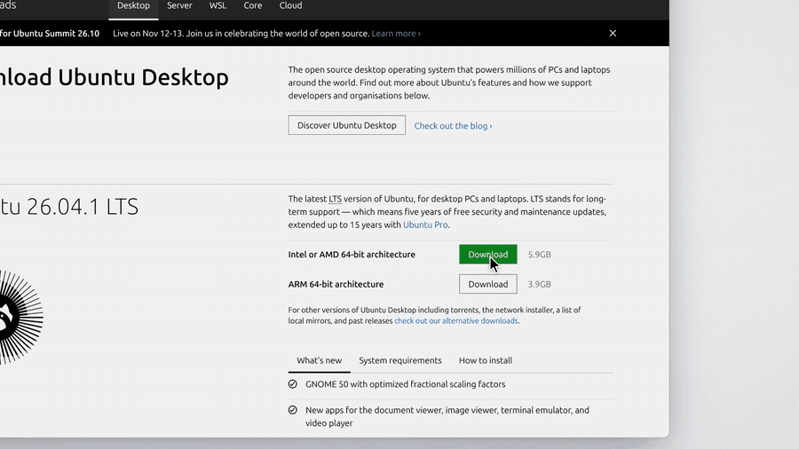

<sub>▶&nbsp; <a href="https://github.com/harshsinghsv/swiftdl/releases/download/v0.2.1/swiftdl-launch.mp4"><b>Watch the one-minute launch video</b></a></sub>

<br />
<br />

<a href="https://github.com/harshsinghsv/swiftdl/releases/latest"></a>

[Why SwiftDL](#your-browser-is-the-bottleneck) · [Download](#download) · [Features](#features) · [How it works](#how-it-works) · [Browser extension](#browser-extension) · [FAQ](#faq) · [Build from source](#build-from-source)

</div>

---

## Your browser is the bottleneck

Browsers download every file over **a single connection**, and many servers cap how fast each connection can go. Click Download on Ubuntu's 5.9 GB installer and Chrome settles in for nearly an hour:

<p align="center">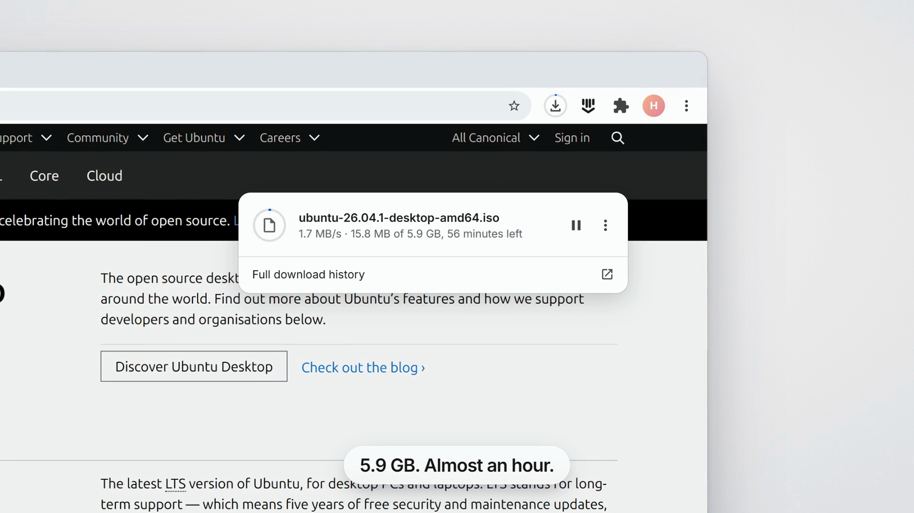</p>

SwiftDL splits the same file across many connections at once, keeps every one of them busy until the last byte, and writes straight into the final file. Same file, same internet:

<p align="center">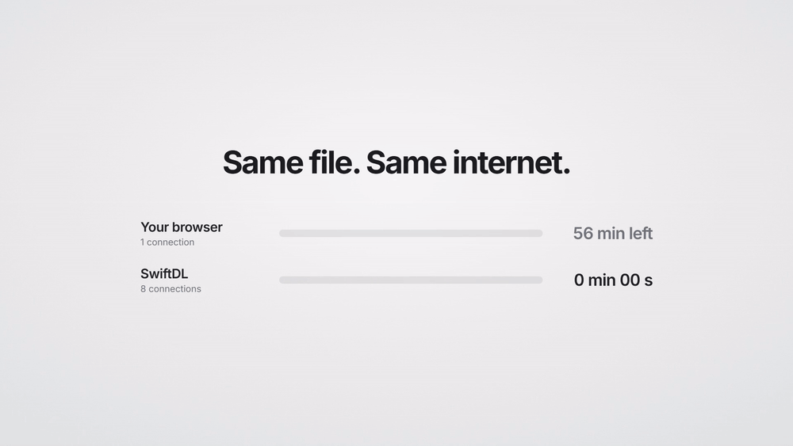</p>

And it saves its progress every second, so a crash, a closed laptop or a dropped Wi-Fi connection never means starting over.

## See it in action

Click a download in your browser and SwiftDL takes it from there, with your cookies, so downloads behind a login still work. On video sites, the **Download video** button on the player lets you pick a quality, from 4K down to audio only:

<p align="center">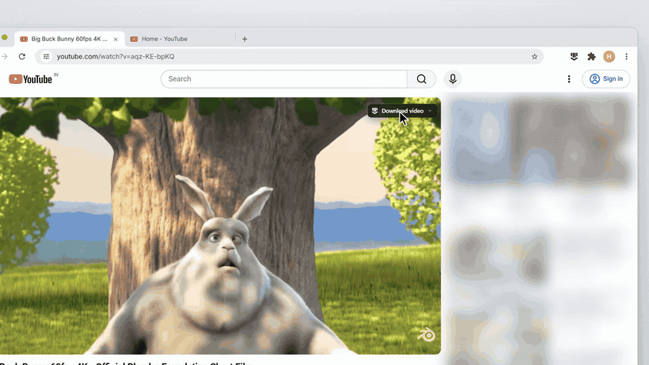</p>

Everything lands in one place: live speed, every connection, queue, pause and resume.

<p align="center">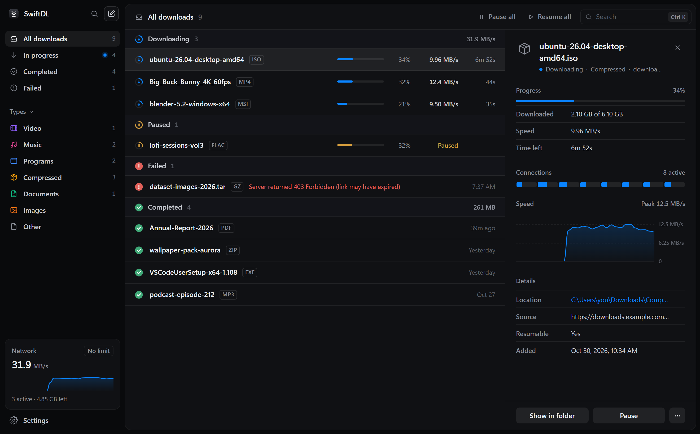</p>

## Download

| Platform | Installer |
| --- | --- |
| **Windows** 10 and 11 | [`SwiftDL_x.y.z_x64-setup.exe`](https://github.com/harshsinghsv/swiftdl/releases/latest), installs per user, no admin rights needed |
| **macOS** (Apple silicon and Intel) | [`SwiftDL_x.y.z_universal.dmg`](https://github.com/harshsinghsv/swiftdl/releases/latest) |
| **Linux** | [`.AppImage`, `.deb` or `.rpm`](https://github.com/harshsinghsv/swiftdl/releases/latest) |

Then add the [browser extension](#browser-extension) so SwiftDL can catch your downloads.

> [!NOTE]
> The official source for SwiftDL is [github.com/harshsinghsv/swiftdl](https://github.com/harshsinghsv/swiftdl). Download installers only from its [Releases page](https://github.com/harshsinghsv/swiftdl/releases).

## Features

<table>
<tr>
<td width="50%" valign="top">

### A window for every download

When your browser hands over a file, a small window asks where to save it. Press **Start** and the same window shows live progress, each connection's position and speed, and finally a **Download complete** summary with **Open** and **Show in folder**.

</td>
<td width="50%" valign="top">
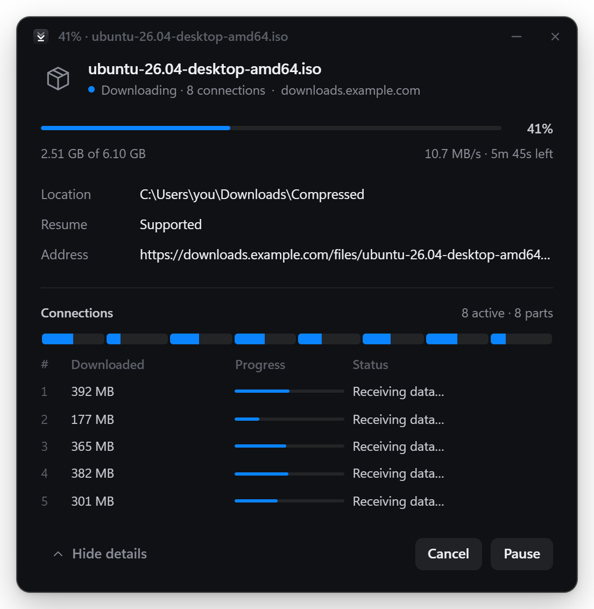
</td>
</tr>
<tr>
<td width="50%" valign="top">
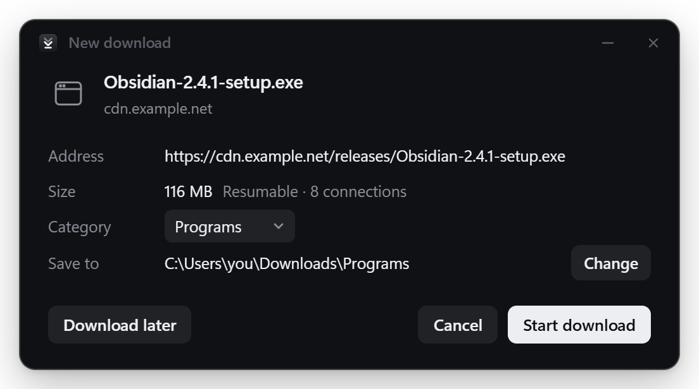
</td>
<td width="50%" valign="top">

### Know what you're getting first

SwiftDL checks the file before downloading: its real name, size, type and whether the server can resume it. Pick a category and folder, or **Download later** to queue it.

</td>
</tr>
<tr>
<td width="50%" valign="top">

### Fast by design

- **Many connections per file**, up to 32.
- **Dynamic segmentation:** when a connection finishes its part, it takes half of the biggest part left, so nothing sits idle near the end.
- **No joining step:** the file is reserved up front and every connection writes straight into it.

</td>
<td width="50%" valign="top">
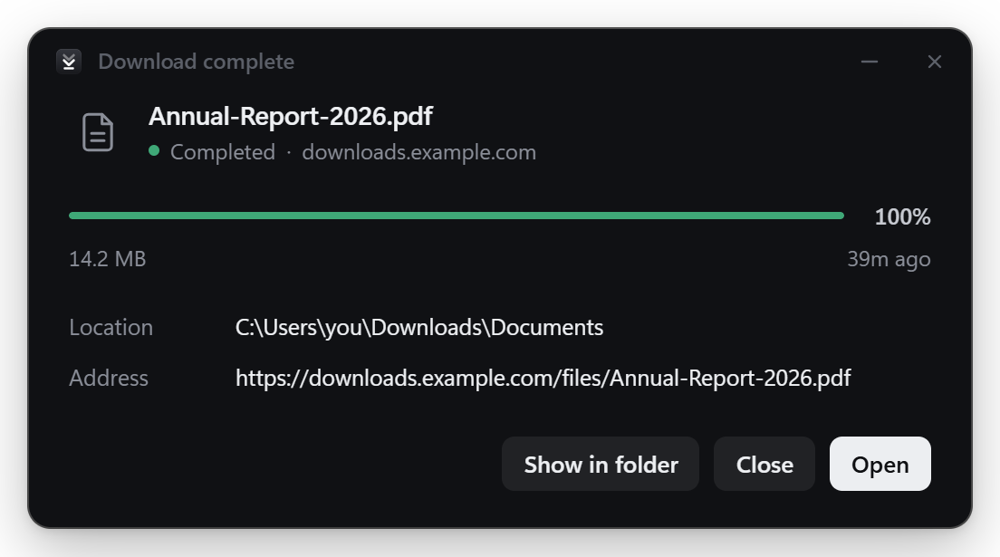
</td>
</tr>
</table>

**Also included**

- **Resume anything.** Pause, quit, lose your connection or crash: SwiftDL continues where it stopped.
- **Download video button.** A button appears over video players and lists the video and audio files the page loaded.
- **Queue and speed limit.** Choose how many downloads run at once and cap total bandwidth.
- **Tidy by default.** Files are sorted into Video, Music, Programs, Compressed and Documents folders.
- **Command palette.** Press <kbd>Ctrl</kbd> <kbd>K</kbd> to find a download or run any action.
- **Lives in the tray.** Close the window and downloads keep going.
- **Light and dark**, following your system.

<div align="center">
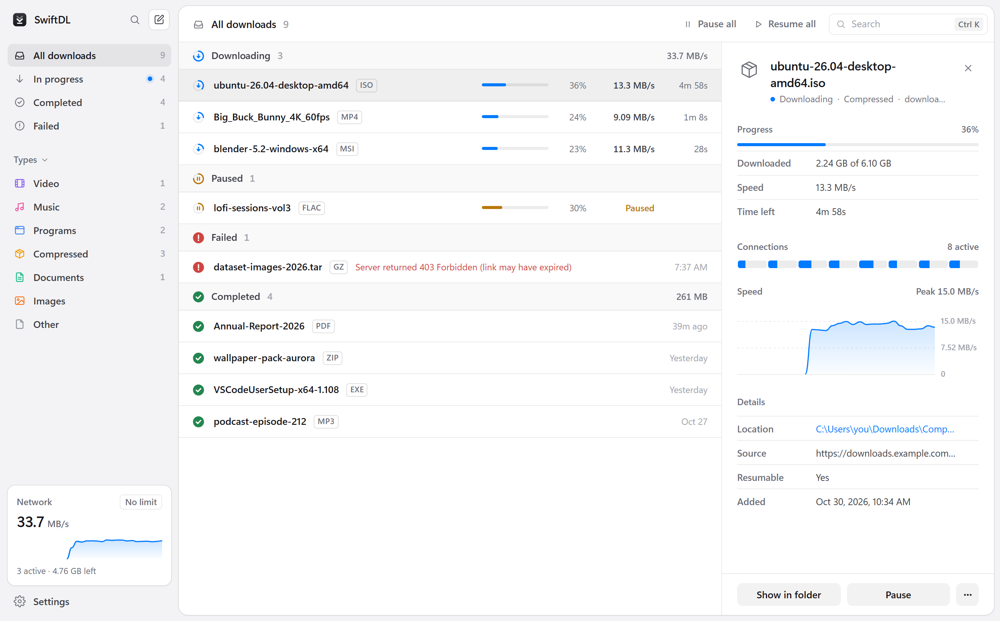
</div>

## How it works

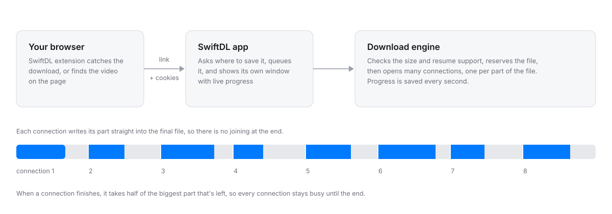

1. **Check.** SwiftDL asks the server for the first byte. The answer reveals the file's size and whether it can be downloaded in parts.
2. **Reserve.** The full-size file is created on disk, so every connection can write to its own place.
3. **Split.** The file is divided into parts, one per connection, each fetched with an HTTP range request.
4. **Rebalance.** When a connection finishes early, it takes over half of the largest remaining part.
5. **Save progress.** The list of missing ranges is saved every second, which is what makes resume work after a crash.

### Benchmark

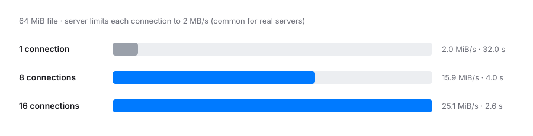

Eight connections finishing in exactly an eighth of the time shows the rebalancing at work: no connection is left idle while another finishes alone. You can run this yourself with [`tools/throttle_server.py`](tools/throttle_server.py).

## Browser extension

The SwiftDL extension works in **Chrome, Edge, Brave and Vivaldi**:

- Sends browser downloads to SwiftDL, with your cookies and referrer.
- Adds **Download with SwiftDL** to the right-click menu on links and media.
- Shows a **Download video** button over video players.
- Hold <kbd>Alt</kbd> while clicking a link to let the browser handle that download.
- Can be turned off for a single site from its popup.

**Install it:** the extension comes with SwiftDL, so there's nothing extra to download. In SwiftDL, click **Add the extension** (or go to **Settings → Browser**) and follow the four steps:

1. Open `chrome://extensions` (or `edge://extensions`).
2. Turn on **Developer mode**.
3. Click **Load unpacked**.
4. Choose SwiftDL's extension folder. The **Open extension folder** button takes you there. On Windows it's `%LOCALAPPDATA%\SwiftDL\extension`.

Use that folder rather than a copy: it stays in place while SwiftDL is installed and is refreshed when SwiftDL updates. If you don't have the app installed, `swiftdl-extension.zip` on the [latest release](https://github.com/harshsinghsv/swiftdl/releases/latest) has the same files.

Once the extension is on the Chrome Web Store, SwiftDL will offer it automatically: Chrome, Edge and Brave show a one-time **New extension added** prompt and you click **Enable**. No browser lets an app install an extension silently.

## FAQ

<details>
<summary><b>Is it really faster?</b></summary>

When the server limits each connection, which many do, yes, by roughly the number of connections (see the [benchmark](#benchmark)). When a single connection already fills your internet line, more connections can't add speed you don't have, but resume and the queue still help.
</details>

<details>
<summary><b>Can it download videos from YouTube?</b></summary>

Yes, and from Vimeo, X, Reddit and other video sites. Click the **Download video** button on the player (or paste the link into **New download**) and pick a quality, from 4K down to audio only. These sites don't serve a plain file, so SwiftDL uses [yt-dlp](https://github.com/yt-dlp/yt-dlp) for them, plus ffmpeg to join the video and audio. Both are downloaded the first time you need them (on macOS and Linux, install ffmpeg with Homebrew or your package manager), and yt-dlp is kept up to date. Only download what you have the right to. DRM-protected video, like Netflix, will never be supported.
</details>

<details>
<summary><b>What happens if my PC crashes mid-download?</b></summary>

Open SwiftDL and press **Resume**. Progress is saved every second, so at most a second of data is downloaded again, as long as the server supports resuming. SwiftDL tells you up front when it doesn't.
</details>

<details>
<summary><b>Do downloads that need a login work?</b></summary>

Yes, when they come from the browser extension. It passes the site's cookies, referrer and user agent along with the link. They're stored with the download so resume works too, and cleared when it completes.
</details>

<details>
<summary><b>Does SwiftDL collect any data?</b></summary>

No. It has no accounts, analytics or telemetry. It only connects to the servers you download from.
</details>

<details>
<summary><b>How do I uninstall it?</b></summary>

Use **Apps & features** on Windows (or remove the app on macOS and Linux). The uninstaller also removes SwiftDL's browser registrations.
</details>

## Build from source

You need [Rust](https://rustup.rs) and the [Tauri prerequisites](https://v2.tauri.app/start/prerequisites/) for your OS.

```bash
git clone https://github.com/harshsinghsv/swiftdl
cd swiftdl
cargo install tauri-cli --version "^2" --locked
cargo test --workspace
cd app/src-tauri && cargo tauri dev
```

| Path | What it is |
| --- | --- |
| [`crates/engine`](crates/engine) | The download engine: probing, segmentation, rebalancing, resume and speed limiting |
| [`crates/cli`](crates/cli) | `swiftdl`, a command-line downloader built on the engine |
| [`app/src-tauri`](app/src-tauri) | The desktop app: download manager, windows, tray and browser integration |
| [`app/ui`](app/ui) | The interface |
| [`extension`](extension) | The Chromium extension (Manifest V3) |
| [`tools`](tools) | A throttled test server and a native-messaging test client |

Working on the interface only? Serve `app/ui` with any static server (`python -m http.server -d app/ui`) and open it in a browser. A simulated backend fills it with downloads, so no Rust build is needed.

## Contributing

Bug reports, ideas and pull requests are welcome. Start with [CONTRIBUTING.md](CONTRIBUTING.md). To report a security problem privately, see [SECURITY.md](SECURITY.md). Release notes are in the [CHANGELOG](CHANGELOG.md).

## License

SwiftDL is released under the [MIT License](LICENSE).
