<div align="center">


# SwiftDL

### 每个下载，都跑满带宽。

面向 Windows、macOS 和 Linux 的免费开源下载管理器。

[](https://github.com/harshsinghsv/swiftdl/releases/latest)
[](https://github.com/harshsinghsv/swiftdl/actions/workflows/ci.yml)
[](#下载)
[](#工作原理)
[](LICENSE)

<br />

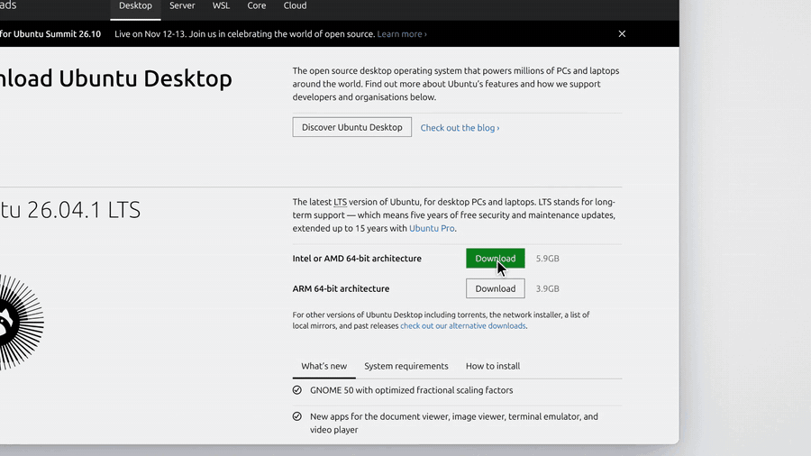

<sub>▶&nbsp; <a href="https://github.com/harshsinghsv/swiftdl/releases/download/v0.2.1/swiftdl-launch.mp4"><b>观看一分钟介绍视频</b></a></sub>

<br />
<br />

<a href="https://github.com/harshsinghsv/swiftdl/releases/latest"></a>

[为什么需要 SwiftDL](#你的浏览器才是瓶颈) · [下载](#下载) · [功能](#功能) · [工作原理](#工作原理) · [浏览器扩展](#浏览器扩展) · [常见问题](#常见问题) · [从源码构建](#从源码构建)

<br />

[English](README.md) · **简体中文**

</div>

---

## 你的浏览器才是瓶颈

浏览器下载文件时只用**一条连接**，而很多服务器会限制单条连接的速度。在 Ubuntu 官网点击下载 5.9 GB 的安装镜像，Chrome 要花上将近一个小时：

<p align="center">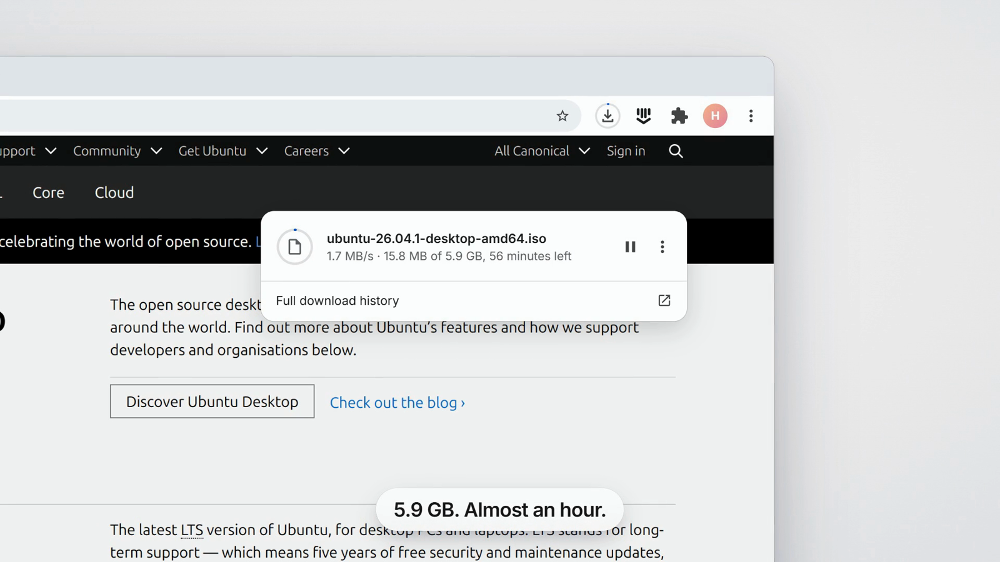</p>

SwiftDL 把同一个文件拆到多条连接上同时下载，让每条连接都忙到最后一个字节，并直接写入最终文件。同样的文件、同样的网络：

<p align="center">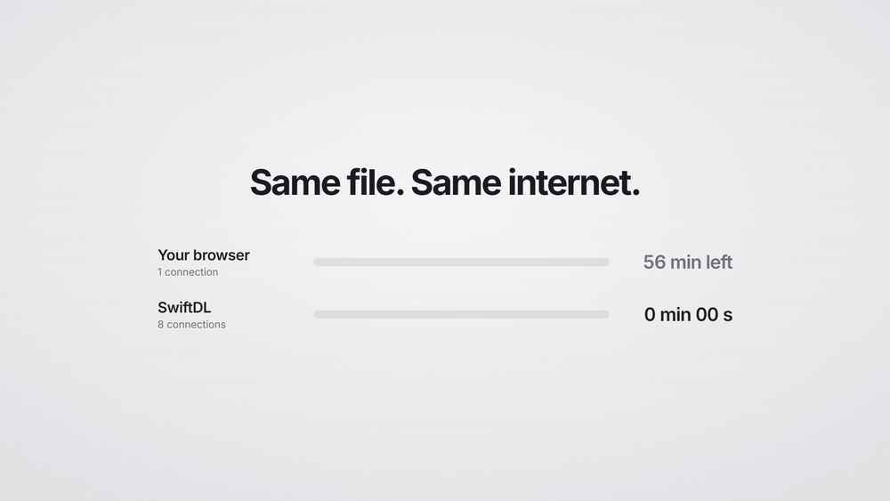</p>

而且它每秒保存一次进度，所以崩溃、合上笔记本或 Wi-Fi 断开都不会让你从头再来。

## 实际效果

在浏览器里点击下载，SwiftDL 就会接手，并带上你的 Cookie，因此需要登录的下载也能正常进行。在视频网站上，播放器上的**下载视频**按钮可以让你选择清晰度，从 4K 到仅音频：

<p align="center">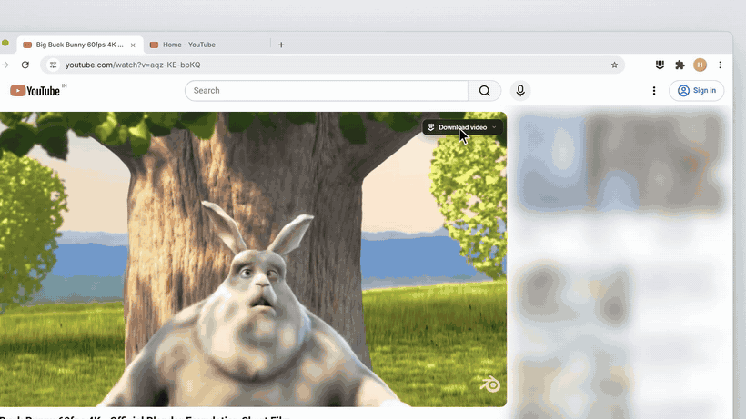</p>

所有内容集中在一处：实时速度、每条连接、队列、暂停与继续。

<p align="center">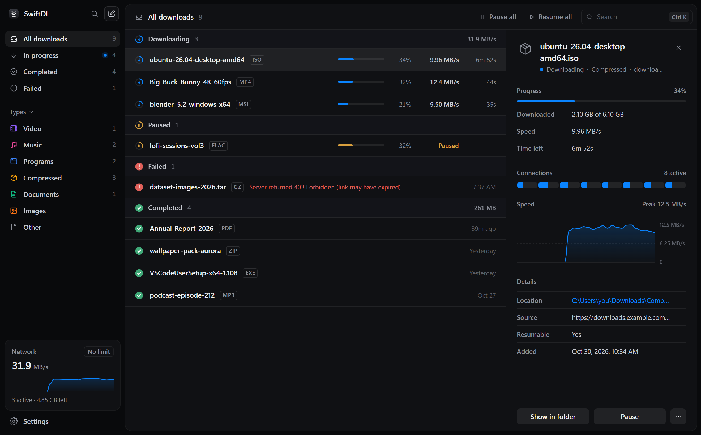</p>

## 下载

| 平台 | 安装包 |
| --- | --- |
| **Windows** 10 和 11 | [`SwiftDL_x.y.z_x64-setup.exe`](https://github.com/harshsinghsv/swiftdl/releases/latest)，按用户安装，无需管理员权限 |
| **macOS**（Apple 芯片和 Intel） | [`SwiftDL_x.y.z_universal.dmg`](https://github.com/harshsinghsv/swiftdl/releases/latest) |
| **Linux** | [`.AppImage`、`.deb` 或 `.rpm`](https://github.com/harshsinghsv/swiftdl/releases/latest) |

然后安装[浏览器扩展](#浏览器扩展)，让 SwiftDL 能接管你的下载。

> [!NOTE]
> SwiftDL 的官方来源是 [github.com/harshsinghsv/swiftdl](https://github.com/harshsinghsv/swiftdl)。请只从它的 [Releases 页面](https://github.com/harshsinghsv/swiftdl/releases)下载安装包。

## 功能

<table>
<tr>
<td width="50%" valign="top">

### 每个下载都有自己的窗口

浏览器把文件交过来时，会弹出一个小窗口询问保存位置。按下**开始**，同一个窗口就会显示实时进度、每条连接的位置和速度，最后给出**下载完成**摘要，附带**打开**和**在文件夹中显示**。

</td>
<td width="50%" valign="top">
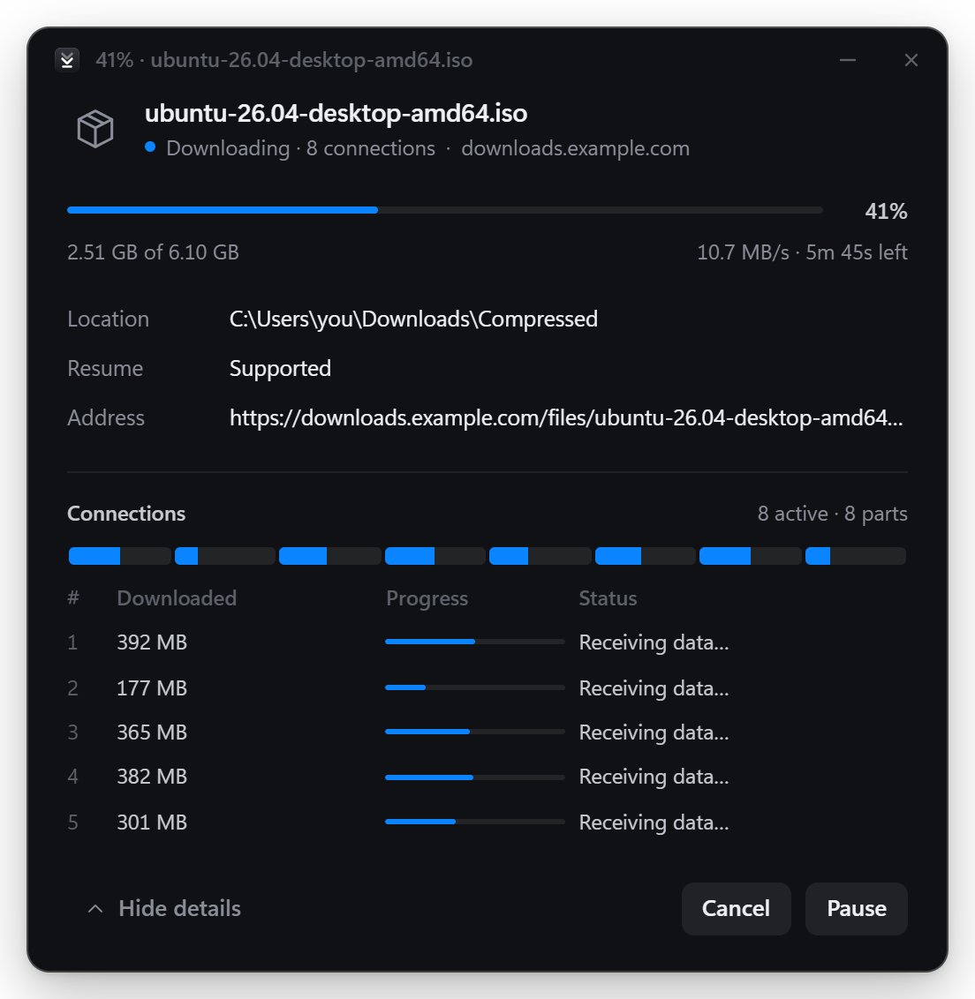
</td>
</tr>
<tr>
<td width="50%" valign="top">
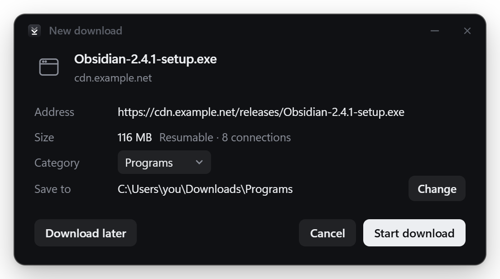
</td>
<td width="50%" valign="top">

### 下载前先看清楚

SwiftDL 会在下载前检查文件：真实文件名、大小、类型，以及服务器是否支持续传。选好分类和文件夹，或者点**稍后下载**加入队列。

</td>
</tr>
<tr>
<td width="50%" valign="top">

### 天生就快

- **每个文件多连接**，最多 32 条。
- **动态分段：** 某条连接完成后，会接手剩余最大分段的一半，所以临近结束时也不会有连接闲着。
- **没有合并步骤：** 文件一开始就按完整大小预留，每条连接直接写入其中。

</td>
<td width="50%" valign="top">
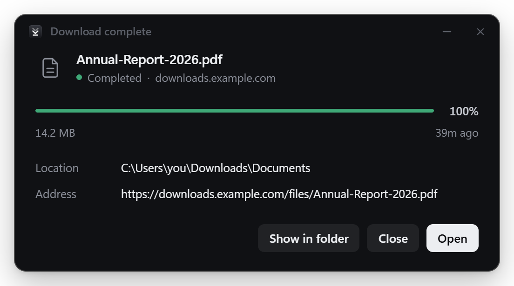
</td>
</tr>
</table>

**还包括**

- **什么都能续传。** 暂停、退出、断网或崩溃后，SwiftDL 会从停下之处继续。
- **种子和磁力链接。** 挑选需要的文件；SwiftDL 能打开任何地方的磁力链接和 .torrent 文件。
- **下载视频按钮。** 播放器上方会出现按钮，列出页面加载的视频和音频文件。
- **队列与限速。** 设置同时下载的数量，并限制总带宽。
- **默认就整齐。** 文件自动分到视频、音乐、程序、压缩包和文档文件夹。
- **命令面板。** 按 <kbd>Ctrl</kbd> <kbd>K</kbd> 查找下载或执行任意操作。
- **常驻托盘。** 关闭窗口后下载继续进行。
- **浅色与深色。** 跟随系统，或在设置中选择。

<div align="center">
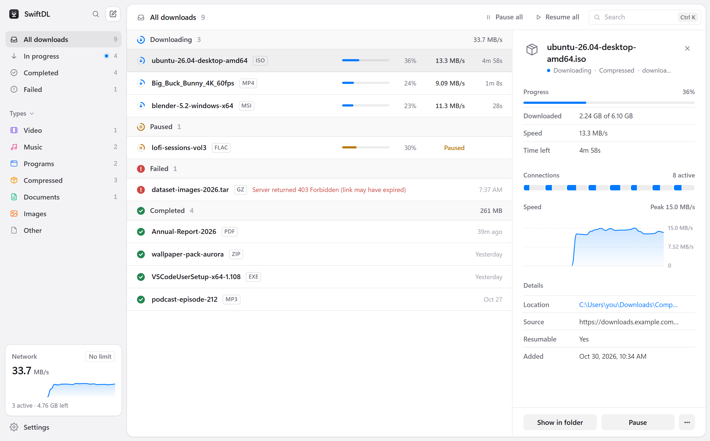
</div>

## 工作原理

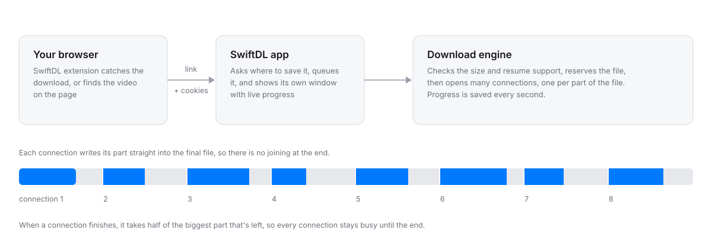

1. **检查。** SwiftDL 向服务器请求第一个字节，由此得知文件大小以及能否分段下载。
2. **预留。** 在磁盘上创建完整大小的文件，让每条连接都有自己的写入位置。
3. **拆分。** 文件被分成若干分片，每条连接负责一片，各用一次 HTTP range 请求获取。
4. **再平衡。** 某条连接提前完成时，会接手剩余最大分片的一半。
5. **保存进度。** 每秒保存一次尚未完成的范围列表，这正是崩溃后能续传的原因。

### 基准测试

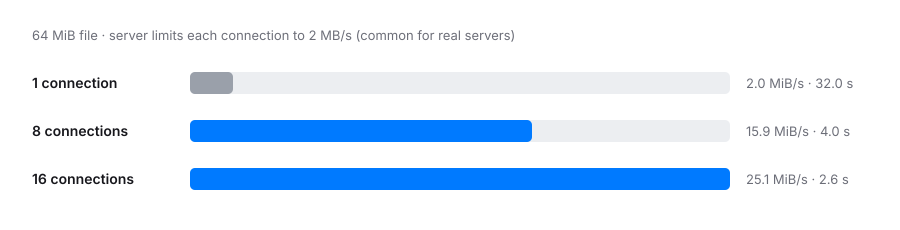

八条连接恰好用八分之一的时间完成，说明再平衡确实在起作用：没有连接会在别的连接独自收尾时闲着。你可以用 [`tools/throttle_server.py`](tools/throttle_server.py) 自己复现。

## 浏览器扩展

SwiftDL 扩展支持 **Chrome、Edge、Brave、Vivaldi 和 Firefox**：

- 把浏览器的下载交给 SwiftDL，带上你的 Cookie 和来源页。
- 在链接和媒体上右键，菜单里有**用 SwiftDL 下载**。
- 在视频播放器上方显示**下载视频**按钮。
- 点击链接时按住 <kbd>Alt</kbd>，这一次仍由浏览器下载。
- 可以在扩展弹窗里对单个网站关闭。

**Firefox：** 从 [Firefox Add-ons](https://addons.mozilla.org/firefox/addon/swiftdl-integration/) 安装，或在 SwiftDL 的**设置 → 浏览器**中点击**添加到 Firefox**。

**Chrome、Edge、Brave 和 Vivaldi：** 扩展随 SwiftDL 一起提供，无需另外下载。在 SwiftDL 中点击**添加扩展**（或进入**设置 → 浏览器**），按四步操作：

1. 打开 `chrome://extensions`（或 `edge://extensions`）。
2. 打开**开发者模式**。
3. 点击**加载已解压的扩展程序**。
4. 选择 SwiftDL 的扩展文件夹。**打开扩展文件夹**按钮会直接带你过去。在 Windows 上是 `%LOCALAPPDATA%\SwiftDL\extension`。

请使用那个文件夹而不是复制一份：只要 SwiftDL 还安装着，它就一直在原处，并随 SwiftDL 更新而刷新。如果你还没安装应用，[最新发布](https://github.com/harshsinghsv/swiftdl/releases/latest)里的 `swiftdl-extension.zip` 含有同样的文件。

等扩展上架 Chrome 应用商店后，SwiftDL 会自动提示安装：Chrome、Edge 和 Brave 会显示一次性的**已添加新扩展程序**提示，点击**启用**即可。没有任何浏览器允许应用静默安装扩展。

## 常见问题

<details>
<summary><b>真的会更快吗？</b></summary>

如果服务器限制了单条连接的速度（很多服务器都会），那么是的，大约能快上连接数的倍数（见[基准测试](#基准测试)）。如果单条连接已经跑满你的宽带，更多连接也不会凭空变出带宽，但续传和队列仍然有用。
</details>

<details>
<summary><b>能下载 YouTube 的视频吗？</b></summary>

可以，也支持 Vimeo、X、Reddit 等视频网站。点击播放器上的**下载视频**按钮（或把链接粘贴进**新建下载**），然后选择清晰度，从 4K 到仅音频。这些网站不直接提供普通文件，所以 SwiftDL 会使用 [yt-dlp](https://github.com/yt-dlp/yt-dlp)，并用 ffmpeg 合并视频和音频。两者都会在第一次需要时自动下载（macOS 和 Linux 上请用 Homebrew 或包管理器安装 ffmpeg），yt-dlp 会保持更新。请只下载你有权下载的内容。像 Netflix 这样的 DRM 加密视频永远不会被支持。
</details>

<details>
<summary><b>下载到一半电脑崩溃了怎么办？</b></summary>

打开 SwiftDL，点击**继续**。进度每秒保存一次，所以最多只会重新下载一秒的数据——前提是服务器支持续传；不支持时 SwiftDL 会提前告诉你。
</details>

<details>
<summary><b>需要登录的下载能用吗？</b></summary>

能，只要下载是从浏览器扩展发起的。扩展会把网站的 Cookie、来源页和 User-Agent 随链接一起传过来。它们会随下载一起保存，以便续传，并在完成后清除。
</details>

<details>
<summary><b>SwiftDL 会收集数据吗？</b></summary>

不会。它没有账号、统计或遥测，只会连接你正在下载的服务器。
</details>

<details>
<summary><b>怎么卸载？</b></summary>

Windows 上使用**应用和功能**（macOS 和 Linux 上移除应用即可）。卸载程序也会清理 SwiftDL 注册的浏览器集成。
</details>

## 从源码构建

你需要 [Rust](https://rustup.rs) 和对应系统的 [Tauri 前置依赖](https://v2.tauri.app/start/prerequisites/)。

```bash
git clone https://github.com/harshsinghsv/swiftdl
cd swiftdl
cargo install tauri-cli --version "^2" --locked
cargo test --workspace
cd app/src-tauri && cargo tauri dev
```

| 路径 | 内容 |
| --- | --- |
| [`crates/engine`](crates/engine) | 下载引擎：探测、分段、再平衡、续传和限速 |
| [`crates/cli`](crates/cli) | `swiftdl`，基于该引擎的命令行下载器 |
| [`app/src-tauri`](app/src-tauri) | 桌面应用：下载管理、窗口、托盘和浏览器集成 |
| [`app/ui`](app/ui) | 界面 |
| [`extension`](extension) | Chromium 扩展（Manifest V3） |
| [`tools`](tools) | 限速测试服务器和 native-messaging 测试客户端 |

只改界面？界面是 TypeScript，用 Vite 构建：在 `app/` 里运行 `npm install` 和 `npm run dev`，然后打开 http://localhost:5179。模拟后端会填入下载数据，不需要编译 Rust。在用 Cargo 构建应用之前，先运行一次 `npm run build`。

## 参与贡献

欢迎提交问题、想法和拉取请求。请先阅读 [CONTRIBUTING.md](CONTRIBUTING.md)。如需私下报告安全问题，见 [SECURITY.md](SECURITY.md)。版本说明在 [CHANGELOG](CHANGELOG.md)。

## 许可证

SwiftDL 基于 [MIT 许可证](LICENSE)发布。
